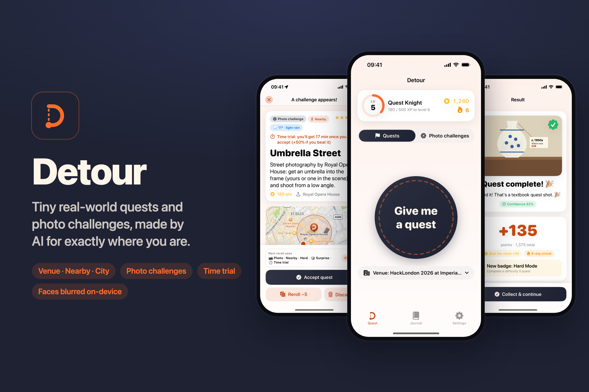
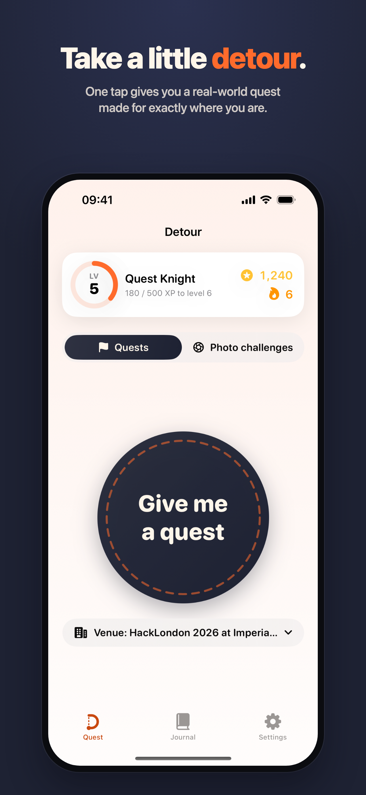
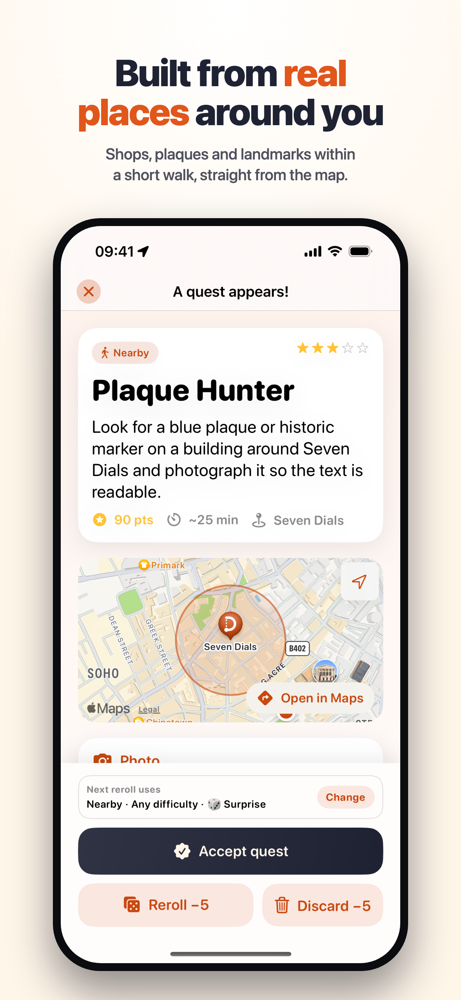
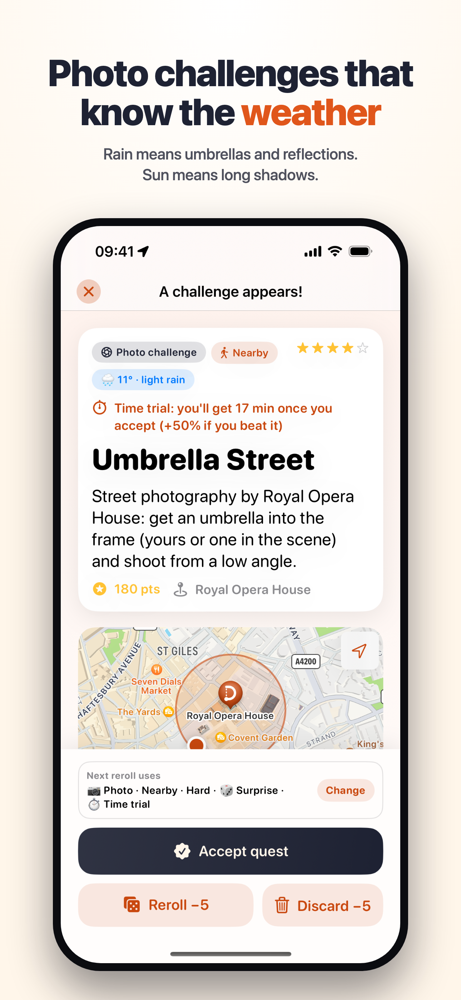
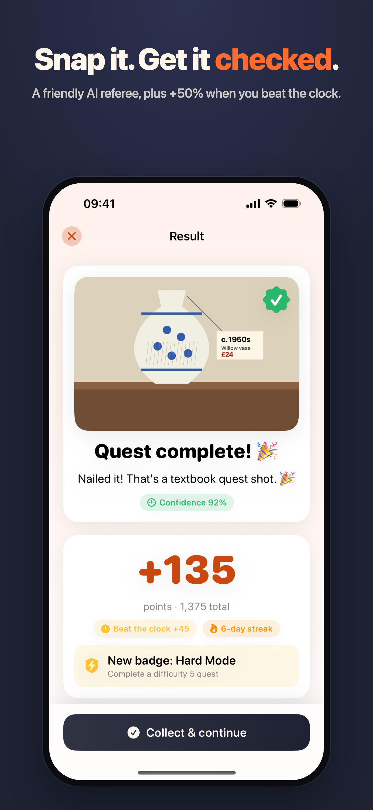

<p align="center">
  
</p>

# Detour

**Tiny real-world quests and photo challenges for iPhone, made for exactly where you are.**

Built for [DurHack 2026](https://durhack.com).

Tap the big button and Detour gives you a quest for the venue you're at, the streets nearby or the wider city. Do it, take a photo, and a lenient AI referee checks it. Earn points, level up, keep a streak and collect badges.

> *"Find an antique shop nearby and find a vase that looks at least 50 years old. Photograph it together with its label or price tag."*

<p align="center">
  
  
  
  
</p>

Built with Swift and SwiftUI for iOS 17+. There's no backend: the app talks straight to the AI you pick (Claude, Gemini/Gemma, or an offline demo mode) using your own API key.

**Contents:** [Features](#features) · [Try it](#try-it) · [API keys](#api-keys) · [How it works](#how-it-works) · [Privacy](#privacy) · [AI providers](#ai-providers) · [Testing](#testing) · [Development](#development)

---

## Features

- **Three ranges.** *Venue* (describe where you are in one line), *Nearby* (about 1 km on foot, real places from Apple Maps) or *City*.
- **Easy, medium or hard.** Quests are rated 1–5 stars, and hard really is hard: *"find a table with at least 15 cans on it"*.
- **Photo challenges** that use the current weather and light. Rain might get you *"street photography by the theatre with an umbrella in the frame"*.
- **Time trial** (optional). A countdown based on difficulty and distance; beat it for +50% points.
- **People quests** (opt-in), like *"find someone who's had 5 Monsters today"*. Faces are blurred on your phone before anything is sent.
- **Open in Maps.** Directions to the quest's place in Apple Maps or Google Maps.
- **Progression.** Points × difficulty, XP and levels, daily streaks, 10 badges and a journal of every detour.
- **Fair play.** Two free tries per quest, then extra tries cost points (more each time). Rerolling or discarding a quest costs 5 points.
- **Never pay-to-win.** No quest ever requires spending money.

---

## Try it

### In the Simulator (2 minutes)

You need a Mac with Xcode 16 or later (built with Xcode 27.2) and an iOS 17+ simulator.

```sh
Scripts/run-simulator.sh                     # builds, boots "iPhone 15 Pro", sets a London location, launches
DEVICE="iPhone 15" Scripts/run-simulator.sh  # pick another simulator
```

Or open `SideQuest.xcodeproj` in Xcode, pick an iPhone simulator and press **⌘R**.

In the simulator the app starts in **demo mode**: canned quests and verdicts, no API key, no cost. The simulator has no camera, so **Take photo** offers three bundled test photos labelled *should pass*, *should be unsure* and *should fail*. To try the real AI, go to Settings → AI → Provider and add a key.

### On your iPhone (free Apple ID)

You don't need a paid developer account.

1. **Add your Apple ID to Xcode:** Xcode → Settings → Accounts → **+** → Apple ID.
2. **Open the project:** `SideQuest.xcodeproj`, then select the **SideQuest** target → **Signing & Capabilities**.
3. **Set signing:** tick *Automatically manage signing*, choose your **Personal Team**, and change the **Bundle Identifier** to something unique, such as `dev.yourname.SideQuest`.
4. **Connect your iPhone** with a cable, unlock it and tap *Trust This Computer*.
5. **Turn on Developer Mode** on the iPhone: Settings → Privacy & Security → Developer Mode → On, then restart.
6. **Pick your iPhone** as the run destination in Xcode's toolbar and press **⌘R**.
7. **First time only:** if iOS says the developer isn't trusted, go to Settings → General → VPN & Device Management → your Apple ID → **Trust**, then open Detour again.

Apps signed with a free account expire after **7 days**. Press ⌘R again to reinstall; your progress is kept. On a real device the app defaults to Claude, and onboarding asks for your key (or tap *Try demo mode*).

---

## API keys

Keys are stored **only in the iOS Keychain** on your device: never in UserDefaults, the repo, logs or crash reports. **Settings → Remove key** deletes them. The app never uses subscription logins (Claude, ChatGPT, Gemini CLI), only your own API key.

### Claude

1. Go to **[platform.claude.com](https://platform.claude.com)** and sign in or create an account.
2. Add some credit under **Billing**. API usage is pay-as-you-go and separate from a Claude.ai subscription.
3. Open **[API keys](https://platform.claude.com/settings/keys)** → **Create key** and copy it. It starts with `sk-ant-` and is shown only once.
4. Paste it during onboarding, or later in **Settings → Claude API key**. The app checks it with Anthropic's free Models endpoint.

Roughly what it costs (estimates from list prices; the in-app debug counter shows live estimates):

| Action | Model | Approx. cost |
|---|---|---|
| Generate a quest | Claude Haiku 5.5 | ~$0.001 |
| Check a photo | Claude Haiku 5.5 | ~$0.001 |
| Re-check an "unsure" photo (optional) | Claude Sonnet 5.5 | ~$0.01 |
| Research a venue (once per venue, cached) | Haiku 5.5 + up to 5 web searches ($10 / 1,000) | ~$0.05 |

### Gemini (free tier available)

1. Go to **[Google AI Studio](https://aistudio.google.com/apikey)** → **Get API key** → create a key.
2. In the app, pick *I have a Gemini key instead* during onboarding, or **Settings → API keys → Add Gemini API key**. Then choose **Gemini (Google)** as the provider and a model:
   - **Gemini 3.5 Flash-Lite** (default, fast) or **Gemini 3.8 Flash** (stronger, used for re-checks).
   - **Gemma 4 31B / 26B** (open models, free tier only, lenient with photos). Gemma gets the JSON format in its prompt instead of a schema, and the same validators check everything it returns.
3. The free tier has rate limits; when you hit one, the app says Gemini is "cooling down". Google may use free-tier prompts and photos to improve its products (the in-app privacy note says so).

---

## How it works

```
Tap "Give me a quest"
  → context: Venue (your one-line description + cached web research)
             or Nearby/City (real MapKit place names and categories, never coordinates)
  → the AI writes a quest as structured JSON
  → validators: JSON shape · target place exists · money · safety · difficulty · proof rules
       └ on failure: feed the reasons back and regenerate (at most 2 retries, then a friendly error)
  → Accept, reroll or discard (−5 points each for the last two, never below zero)
  → take photos (in-app camera only) → geofence check (Nearby/City) → duplicate check
  → faces blurred on the phone, photos resized, EXIF/GPS stripped, sent with the success criteria
  → lenient verdict: pass / unsure (count it, retake or re-check) / fail (try again)
  → points × difficulty, XP, level, streak, badges, history thumbnail, confetti and haptics
```

The details, if you're curious:

<details>
<summary><b>Difficulty</b></summary>

"Hard" is meant to be hard. The prompt includes a 1–5 scale with concrete examples ("a table with at least 15 cans on it", "three different sponsor logos in one photo"). `DifficultyValidator` rejects quests whose difficulty doesn't match what you asked for, and "hard" quests with fewer than 3 criteria or no count or precise detail. Claude also thinks a bit harder (medium effort) for hard quests.
</details>

<details>
<summary><b>Photo challenges</b></summary>

Switch **Quests / Photo challenges** above the big button. Photo challenges are briefs about seeing and composing a shot. Easy is one simple brief ("something green filling half the frame"), medium adds a technique (leading lines, reflections, framing), and hard combines a real nearby place, a subject, the current weather or light, and a technique. In Nearby/City the app fetches the weather and sunset time from [Open-Meteo](https://open-meteo.com) (free, no key) using your location rounded to about 1 km. The AI only gets a description like "light rain, 11°C, sunset at 16:11", and the referee ends each verdict with a short photography tip.
</details>

<details>
<summary><b>Time trial</b> (Settings → Time trial)</summary>

A countdown starts when you accept a quest. Its length is the time to find or set up the shot for that difficulty (3–20 min, more for multi-photo quests) plus travel time to the target (walking pace for the first 2 km, bus or bike pace beyond, +25% because routes aren't straight), between 2 and 120 minutes. Submit your photos before it hits zero for **+50% points**; running out just means no bonus. If a photo fails, the clock keeps running until the photos that pass go in. See `TimeTrial` in `Progression.swift`.
</details>

<details>
<summary><b>People quests</b> (off by default)</summary>

Turn on **Quests with other people** in the quick picks or Settings to get social quests. Rules, in the prompt and in `SafetyValidator`: ask before photographing anyone or their things; the proof is visible evidence, never a face, name or identity (hands, a thumbs up, their 5 empty cans, a sticky note they wrote); no children, busy staff or security. With the toggle off, quests never need anyone else.
</details>

<details>
<summary><b>Faces are blurred on the phone</b></summary>

Before any photo is sent, Apple's on-device Vision framework finds faces (and the heads of people facing away) and pixelates them so they can't be recovered. If people are in the shot, or the quest involves people, you see **exactly what will be sent** and can tap to blur anything else, like a name badge or a screen. If face detection can't run, the app always shows that review screen instead of sending the photo. Only the blurred version is sent or saved in your history.
</details>

<details>
<summary><b>One photo per find</b></summary>

A quest can ask for 1–4 photos. When it's about finding separate things ("three different sponsor logos"), you take one photo per find into a tray, with **Check now** if you can't find them all, and the referee looks at the set together. Things that naturally sit together (cans on one table) stay a single photo. People in the background are fine; quests never demand an empty frame (`ProofRulesValidator`).
</details>

<details>
<summary><b>Tries, rerolls and discards</b></summary>

Each quest gets **2 free photo checks**: the first go plus one retry. A check only counts once the referee has looked, so being outside the quest area, a reused photo, a network error or the stronger re-check don't use one. After that, **Buy another try** spends points: 10% of the quest's points, doubling each time and rounded up to 5 (a 90-point quest costs 10, 20, 40, 75…). Points never go below zero, and a pass still pays in full. Tune it in `Tries` (`Progression.swift`).

On a new quest you can **Accept**, **Reroll** (−5 points) or **Discard** (also −5, since discarding and asking again is a reroll by another name). A strip above the buttons shows the settings the next quest will use, with a **Change** shortcut. If you change anything, it says "NEW settings" and the button becomes **Reroll · new settings**.
</details>

<details>
<summary><b>Scopes and maps</b></summary>

- **Venue:** type one line, e.g. *"DurHack 2026 at Durham University"*. The AI researches it once with web search (layout, rooms, events, sponsors, etiquette) and the result is cached. No GPS is used, and quests may only target researched areas or "any".
- **Nearby:** about 1 km on foot, using when-in-use location, `MKLocalPointsOfInterestRequest` and themed `MKLocalSearch` queries. Pubs, bars, casinos, vape shops and similar are filtered out before the AI sees them.
- **City:** landmarks, museums, markets and so on within about 8 km.

When a Nearby or City quest names a specific place, the map on the quest card has an **Open in Maps** button. Pick Apple Maps or Google Maps for directions (walking under 2 km, public transport beyond). Only the place's location is passed on; Google Maps opens in its app if installed, otherwise in the browser.

Theme (social, creative, explore, food, history or surprise me) and difficulty are quick picks that the app remembers.
</details>

<details>
<summary><b>Money rules</b></summary>

- **Off (default):** quests never mention buying, paying, tickets, fees or anything that costs money, and the cost estimate must be 0.
- **On:** a quest *may* include one optional purchase up to the slider value (£0–£50, default £5), but it must always be fully doable for free. `requires_purchase` must be false, `free_path` must be present and free, success criteria can't depend on buying, and spending never earns more points.
- In both modes, quests never pressure you ("treat yourself", "don't miss out", "bonus points if you buy…").

Enforced in the prompt **and** in code by `MoneyRulesValidator`.
</details>

<details>
<summary><b>Safety rules</b></summary>

Only legal, safe, public, accessible places. No trespassing, restricted or staff-only areas, climbing, roofs, railways or isolated places at night. No alcohol, gambling or age-restricted items. Don't disrupt businesses, staff or talks, and no backstage at a venue. People are only involved when you've turned that on, and then only with their permission. Enforced in the prompt and by `SafetyValidator`, which understands simple negations ("don't go into staff-only areas" is fine).
</details>

<details>
<summary><b>Lenient referee</b></summary>

The model is told to give the benefit of the doubt, and the app adds its own policy: a "fail" with low confidence, or with most criteria met, becomes "unsure". "Unsure" offers **Count it!** (which passes), a retake if you have a try left, and an optional re-check with a stronger model. The app always says the AI only judges what's visible and can't confirm age, authenticity, price or location.
</details>

---

## Privacy

Also shown in the app under Settings → Privacy.

- **What's sent to the AI:** quest context (scope, theme, your venue line, nearby place **names**) and your photos, to the provider you choose: Anthropic (Claude) or Google (Gemini). In demo mode, nothing. On Google's free tier, Google may use them to improve its products.
- **Photos:** resized, **faces blurred**, and re-encoded from raw pixels before upload, so **no EXIF or GPS data** leaves the phone. Unit tests check both.
- **Location:** your precise location never leaves the phone. It's used only for Apple Maps searches and the quest-area check. For photo challenges, a location rounded to about 1 km is sent to Open-Meteo for the weather.
- **Storage:** there's no Detour server. History, points and badges stay on your device (SwiftData).

---

## AI providers

All app logic talks to one protocol, `AIProvider` (`research(venue:)`, `generateQuest(context:)`, `verify(photos:criteria:…)`), and every response goes through the same validators.

- **Claude (default):** a small typed `URLSession` client for the Anthropic Messages API in `SideQuest/AI/Claude/`. Model IDs, the API version, effort levels and prices live in one file, [`SideQuest/Config/AIConfig.swift`](SideQuest/Config/AIConfig.swift).
  - `anthropic-version: 2026-10-21`; sampling parameters like `temperature` aren't sent.
  - `claude-haiku-5-5` for quests, photo checks and research; `claude-sonnet-5-5` for optional re-checks.
  - Structured outputs (`output_config.format` with a JSON schema) for every JSON response.
  - Web search (`web_search_20250305`, at most 5 searches per venue, `pause_turn` handled). If web search is disabled for your organisation, research falls back to the model's own knowledge.
  - Friendly messages for an invalid key, no credit, rate limits (429 retried once, honouring `retry-after`), overload, being offline, refusals and truncation.
- **Gemini / Gemma** (`SideQuest/AI/Gemini/`): a small typed client for the Gemini Developer API (`generateContent`, key in the `x-goog-api-key` header, JSON-schema output for Gemini models, Google Search grounding for venue research when your key allows it, 429 → "cooling down"). No Firebase or SDK needed.
- **Demo mode** (`MockAIProvider`): canned quests for every scope, theme and mode, plus pass/unsure/fail verdicts. A unit test checks that every canned quest passes the real validators.

---

## Testing

- **175 unit tests**, all passing: the JSON, money, safety, difficulty, place and proof validators; scoring, streaks, badges, tries and time trials; the geofence check; the Keychain wrapper; EXIF/GPS stripping; face blurring (a detected face can't be detected afterwards); duplicate-photo detection; the quest retry engine; weather parsing; map links; and the Claude and Gemini clients against a stubbed network (headers, request bodies, retries, error mapping, web-search research and fallbacks, refusals, Gemma's prompt-only JSON).
- **7 UI tests**, all passing, that tap through the app in demo mode on an iPhone 15 Pro simulator: onboarding, Venue and Nearby quests, reroll, discard with new settings, a hard people quest and the photo review screen, multi-photo quests, a photo challenge with a time trial, pass/unsure/fail results, running out of free tries, Open in Maps, the journal and settings.
- **Not tested yet:** live calls to the real Anthropic and Google APIs (no keys were available while building), and running on a physical iPhone (camera, real GPS, face detection on real photos). Request shapes follow the current docs and are checked by the stubbed tests, but do a quick real run before a demo.

```sh
# Unit tests + UI tests (iPhone 15 Pro simulator)
xcodebuild -project SideQuest.xcodeproj -scheme SideQuest \
  -destination 'platform=iOS Simulator,name=iPhone 15 Pro' test

# Unit tests only
xcodebuild … -only-testing:SideQuestTests test
```

UI tests save screenshots to `/tmp/sidequest-shots` (override with `TEST_RUNNER_SCREENSHOT_DIR`).

- **Simulated location:** GPX files in `GPX/` (Covent Garden is the scheme default; also South Kensington and a walk to the British Museum for testing the quest area). In Xcode: Debug → Simulate Location.
- **Test photos:** `SideQuest/Resources/DebugTestPhotos/` (pass, unsure, fail), excluded from Release builds. Regenerate them with `swift Scripts/make_assets.swift .`
- **Debug menu** (Settings → Debug & AI usage): AI call counter and cost per quest, recent calls, the last rejected quest and why, demo verdict mode, "make the first attempt break the rules" (to watch the validators work), test photos on a real device, duplicate checks for test photos, skip the location check, replay onboarding, reset progress.

---

## Development

### Project layout

```
SideQuest/
  App/            App entry, settings (UserDefaults), QuestFlowModel (the quest state machine)
  Config/         AIConfig.swift: model IDs, API version, prices
  Models/         Quest, Verdict, VenueContext, QuestContext, scopes/themes/money settings
  AI/             AIProvider protocol, prompts, JSON schemas, Claude and Gemini clients, demo provider
  Validation/     JSON, money, safety, difficulty, place and proof validators; verdict leniency
  Services/       Quest engine (retries), location, Apple Maps places, geofence, Keychain, images,
                  face blurring, perceptual hash, weather, map links, haptics, AI usage tracker
  Progression/    Scoring, levels, streaks, badges, tries, time trial
  Persistence/    SwiftData models and ProgressStore
  Views/          Onboarding, Home, Quest card + camera, photo review, Result, Journal, Settings
SideQuestTests/   Unit tests
SideQuestUITests/ Demo-mode UI flow tests and the store screenshot captures
GPX/              Simulated locations
Scripts/          run-simulator.sh, make_assets.swift, make_store_screenshots.py
Marketing/        Store and Devpost images, Devpost text
Design/           Logo masters and concepts
project.yml       XcodeGen spec (the generated .xcodeproj is committed too)
```

If you add or remove source files, regenerate the project with `xcodegen` (`brew install xcodegen`), or add them in Xcode as usual.

### Store screenshots

- `Marketing/AppStore/01-home.png` … `06-journal.png`: 1290 × 2796, the 6.7" iPhone App Store size.
- `Marketing/Devpost/cover-3x2.png`: the 2400 × 1600 cover above, for the Devpost gallery.
- `Marketing/raw/`: the plain simulator captures they're built from.

They use demo mode with sample history, fixed demo quests and places, and sample rain (debug builds only, via the `-marketing` launch argument). To regenerate them:

```sh
UDID=<simulator id>   # xcrun simctl list devices
xcrun simctl boot $UDID
xcrun simctl status_bar $UDID override --time "9:41" --dataNetwork wifi --wifiMode active --wifiBars 3 \
  --cellularMode active --cellularBars 4 --batteryState charged --batteryLevel 100
xcodebuild -project SideQuest.xcodeproj -scheme SideQuest -destination "id=$UDID" \
  -only-testing:SideQuestUITests/MarketingScreenshotTests test     # saves to /tmp/detour-marketing/raw
cp /tmp/detour-marketing/raw/*.png Marketing/raw/
python3 Scripts/make_store_screenshots.py   # needs Google Chrome; headlines are at the top of the script
xcrun simctl status_bar $UDID clear
```

### Brand

The logo is a letter D drawn as a route: the dashed spine is the road you planned, the bold bowl is the detour you took, and the dot is you, back on track. Colours: asphalt `#1E2233`, signal orange `#FF6B2C`, cream `#FFF6EA`. Masters are in `Design/brand/` (outlined SVGs); earlier concepts are in `Design/logo-concepts/`.

- The user-facing name and mark live in one place: `AppBrand` in `SideQuest/Views/Shared/Theme.swift`, plus `CFBundleDisplayName` in `project.yml`. Code, targets and the bundle ID still say "SideQuest" on purpose, so existing installs keep their progress and saved API keys.
- App icon: render `Design/brand/detour-app-icon.svg` at 1024 × 1024, flatten it (no transparency), and save it as `SideQuest/Resources/Assets.xcassets/AppIcon.appiconset/AppIcon.png`.
